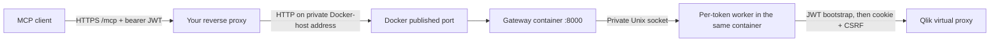

# Docker and an external reverse proxy

## Request flow



The actual request direction is client -> reverse proxy -> Docker ->
container. Responses travel in the opposite direction. All token workers
run inside the same container; they are not additional Docker containers
and do not require access to the Docker socket.

## Build and run

Check out this fork's feature branch on a machine with Docker and Compose.
Create a local `.env` alongside `compose.yaml` containing your real Qlik URL:

```dotenv
QLIK_SERVER_URL=https://qlik.example.com/jwt
QLIK_VERIFY_SSL=false
MCP_PUBLISH_ADDRESS=127.0.0.1
MCP_PUBLISH_PORT=8000
```

Replace the example hostname with your Qlik virtual-proxy hostname. Do not
put user JWTs in `.env`: every client request supplies its own bearer token.
The example retains optional TLS verification toward Qlik, as requested.

```sh
docker compose config
docker compose up -d --build
docker compose ps
docker compose logs --tail=100 qlik-mcp
```

The image runs the same `qlik-sense-mcp-server` startup command, with
`QLIK_MCP_MODE=incoming-jwt`. It binds `0.0.0.0:8000` **inside the container**
so Docker can reach it. Outside Docker, the gateway's bind default remains
`127.0.0.1`. This change applies to incoming-JWT mode; legacy server binding
has not been changed.

The image runs as UID/GID 10001, not root. Compose enables an init process,
a read-only root filesystem, a writable temporary filesystem for worker
sockets, dropped capabilities and resource limits. No Docker socket, host
network mode or persistent token/session storage is needed.

The supplied Docker healthcheck expects HTTP 401 from an unauthenticated
local request. This confirms gateway availability without creating a Qlik
session. It does **not** verify Qlik reachability, licensing or permissions.
The healthcheck is intended for incoming-JWT mode, not legacy mode.

## Choose how your proxy reaches Docker

### Proxy is a process on the same Docker host

Keep `MCP_PUBLISH_ADDRESS=127.0.0.1`. Point the proxy upstream at
`http://127.0.0.1:8000`. The backend is not published on the host's external
interfaces.

### Proxy is on a different machine

Set `MCP_PUBLISH_ADDRESS` to the Docker host's **specific private IP**, then
point the proxy at that private IP and port. Firewall the published port so
only the reverse proxy can reach it. Plain backend HTTP carries the bearer
JWT, so use a trusted private network; for an untrusted network use an
encrypted backend connection or a private tunnel.

Avoid publishing on all host interfaces without a deliberate firewall rule.

### Proxy is another container

`127.0.0.1` in the proxy container is not the Docker host. Prefer attaching
both services to a dedicated shared Docker network and using upstream
`http://qlik-mcp:8000`; remove `ports` from the MCP service in that setup.
Alternatively, route through a suitably restricted published host port.
The proxy itself is deliberately not included or assumed in this repository.

## Required proxy behavior

- Expose the gateway as HTTPS, preferably at `/mcp` on a dedicated hostname.
  Preserve that path when forwarding; do not add or remove a prefix unless
  you have explicitly configured a matching rewrite.
- Preserve the **original Authorization bearer token** on every GET, POST
  and DELETE. Do not overwrite it with proxy authentication credentials.
- Preserve `Mcp-Session-Id`, `Mcp-Protocol-Version`, `Last-Event-ID`, Accept
  and Content-Type. Pass session IDs and WWW-Authenticate back to the client.
- Allow Streamable HTTP/SSE responses. Disable response buffering, caching,
  transformations and compression that delays event delivery.
- Use adequate response/read timeouts. Tool calls can take 240 seconds by
  default; an idle SSE stream may need a substantially longer timeout.
  A cold worker startup can take up to 120 seconds by default.
- Keep a bounded request body and upload timeout. The gateway defaults are
  4 MiB and 30 seconds. Set compatible or stricter proxy limits.
- Do not retry POST requests automatically: an operation may already have
  run even if its response was lost.
- Apply network-level connection/rate limits and never log Authorization
  headers or request bodies containing sensitive business data.

The gateway does not trust forwarded headers as user identity. User
permissions come from the JWT accepted by Qlik, not from an HTTP header
such as X-Forwarded-User.

## Qlik networking and private CAs

The container must resolve and reach `QLIK_SERVER_URL`. Use the actual Qlik
hostname, not `localhost` (which means the container itself). Ensure the
Qlik virtual proxy permits the hostname/Origin used by the Qlik connection.
Host port mappings are only for incoming clients; Qlik connections are
outbound from the container.

For verified TLS with a private CA, mount the CA read-only and add the
container path to the service environment. For example, add to Compose:

```yaml
volumes:
  - ./certs/root.pem:/run/qlik-ca.pem:ro
environment:
  QLIK_VERIFY_SSL: "true"
  QLIK_CA_CERT_PATH: /run/qlik-ca.pem
```

Merge these fields into the existing service; do not replace its other
required environment settings. Certificate/key files and local `.env`
files are excluded from the Docker build context. They are not baked into
the image. TLS verification remains optional and unchanged.

## Capacity, restarts and verification

Compose starts with a conservative 16-token context limit rather than 128,
with 2 GiB memory, two CPUs and a PID limit. These are starting limits, not
benchmarked sizing guarantees: each distinct JWT creates a Python worker
plus Qlik clients and threads. Measure actual usage and adjust together.

Deploy one gateway instance initially. Restarting the container or evicting
a worker drops its MCP session IDs; clients must reinitialize. Multiple
replicas need consistent routing and still consume separate Qlik sessions.
Same-token conversations intentionally share worker and Qlik selection state.

Docker builds need network access to pull the base image and install Python
dependencies. After dependency changes, rebuild the image. Pin an approved
base-image digest and dependency versions for reproducible production builds.

Container build/start and a real proxy-to-Qlik request must be tested on your
host. The authoring environment has no Docker runtime; the Docker image and
Compose startup have not been executed there. Existing SDK/live-Qlik
verification requirements also still apply. See [INCOMING_JWT.md](INCOMING_JWT.md).
